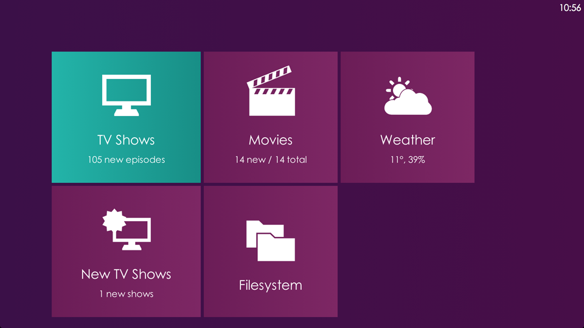

# CMi

CMi is pronounced "See me!", because it wants you to. It's a Mac-based media center like for example XBMC, Boxee, etc. 

## Why I wasn't satisfied with existing systems

Short version: death by a thousand paper cuts.

Longer version: XBMC was the closest to an acceptable system but I still had to write tons of python to sit in front of it just so it would understand the files I was downloading. Then it had all these annoying issues like when you press play there is no visual indication that you actually pressed a button until the video starts playing, so you hit play again and then that pauses the video when it does eventually show up. Oh and the GUI where up on the remote moves you some random direction because the skin doesn't handle these things. Blech.

## What does it do?

* It scans your download folder and automatically figures out if you have episodes from TV shows or movies in there and will handle that correctly. Without any configuration. At all.
* It keeps track of what you've watched.
* Even if you get a power outage it will still remember where you were in the video when you restart the video.
* It will automatically clear out old files by sending them to the trash (not deleting them without a trace!)
* It will show you the weather :P
* It has some nice animations that were heavily inspired by Microsofts Metro style.
* It has a plugin API: https://github.com/boxed/CMi/wiki/Plugin-API

## Installing

1. <a href="https://github.com/boxed/CMi/releases">Download the binary</a>. 
2. Run it (you might need to right-click the file and choose "Run" since I haven't signed the binary).
3. There is no 3!

## Building

1. Make sure Python 3 is installed (Homebrew, pyenv, or python.org).
2. Open up CMi.xcodeproject and hit build. On first launch the app creates a Python virtualenv with the dependencies in `~/Library/Application Support/CMi/venv`.

To work on the web frontend without the app: `python3 -m venv .venv && .venv/bin/pip install -r web_frontend/requirements.txt`, then `cd web_frontend && ../.venv/bin/python CMi/runserver.py`

## Plex

To browse and play from a Plex Media Server, open the Plex tile and enter the code it shows at plex.tv/link. CMi finds your servers and connects to the first address that answers.

You can also skip the sign in by creating `~/Library/Application Support/CMi/plex.json` yourself:

    {"url": "http://192.168.1.10:32400", "token": "YOUR_PLEX_TOKEN"}
